# EDR & Detection Engineering with Wazuh

A home-lab project that deploys Wazuh as an EDR/XDR layer across a small Windows
Active Directory domain, builds five ATT&CK-mapped detections, validates them with
an automated test, runs one configuration-hardening cycle (CIS via Group Policy),
and automatically contains attacks with three self-reverting active responses.
Every attack is a scripted, repeatable simulation committed to the repo; every
detection is verified against the Wazuh indexer API.

---

## Lab environment

| Component | Detail |
| --- | --- |
| Hypervisor | VMware Workstation Pro on an Asus ROG Zephyrus G14 (48 GB RAM) |
| Domain network | VMnet8 (NAT), `10.10.10.0/24`, gateway `10.10.10.2`; DC01 serves DHCP (scope `.100`–`.200`) |
| DC01 | Windows Server 2022, domain `soc.lab`, `10.10.10.10` |
| WS01 / WS02 | Windows 11, domain-joined, Sysmon installed |
| Kali | Attacker VM, `10.10.10.102` |
| WAZUH01 | Ubuntu 26.04, `10.10.10.20`, Wazuh 4.14.9 all-in-one (manager, indexer, dashboard) |

All three Windows hosts run the Wazuh agent (4.14.9), enrolled into a shared
`windows-lab` group that collects Sysmon and the Windows Defender operational log
in addition to the default channels.

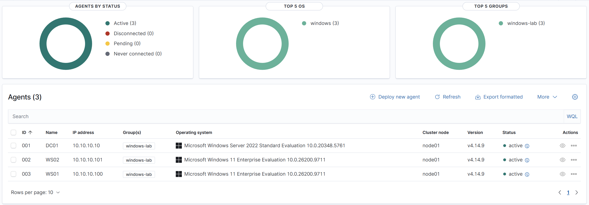

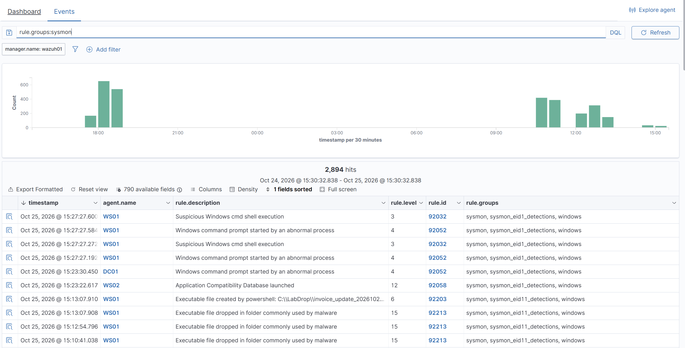

The Wazuh indexer is bound to `127.0.0.1` only. The validation script reaches it
over an SSH tunnel rather than exposing port 9200 to the lab network.

---

## Detections

Five custom detections, each mapped to MITRE ATT&CK, each exercised by a committed
test script. Custom rule IDs start at `100100`.

| # | Detection | Rule ID(s) | ATT&CK | Wazuh capability exercised |
| --- | --- | --- | --- | --- |
| 1 | Mass file encryption (ransomware) | 100110 | T1486 | FIM with who-data + frequency correlation |
| 2 | Malicious file dropped to disk | 100120, 87105 | T1204.002 | FIM real-time + VirusTotal integration |
| 3 | Defender tampering | 100130–100133 | T1562.001 | Defender log collection + custom rules |
| 4 | Password spray → successful logon | 100140, 100141 | T1110.003 → T1078 | Multi-event correlation across users/hosts |
| 5 | CIS baseline hardening | — | (hardening) | Security Configuration Assessment (SCA) |

### 1. Ransomware-style mass encryption (T1486)

File Integrity Monitoring watches `C:\FinanceShare` in **who-data** mode, which
records the *user and process* behind each change — detail plain Sysmon file events
don't give as cleanly. Rule `100110` fires on 40+ FIM events within 30 seconds on a
single host (`same_location`), with an `ignore` window to prevent one attack from
flooding duplicate alerts.

- **Test:** `tests/T1486_mass_encrypt.ps1` (`-Setup`/`-Run`/`-Reset`), guarded to
  refuse any path outside `C:\FinanceShare`.
- **Evidence:** who-data fields `syscheck.audit.process.name` (`powershell.exe`) and
  `syscheck.audit.user.name` captured on the triggering alert.
- **Negative test:** editing a handful of files by hand does not trip the threshold.

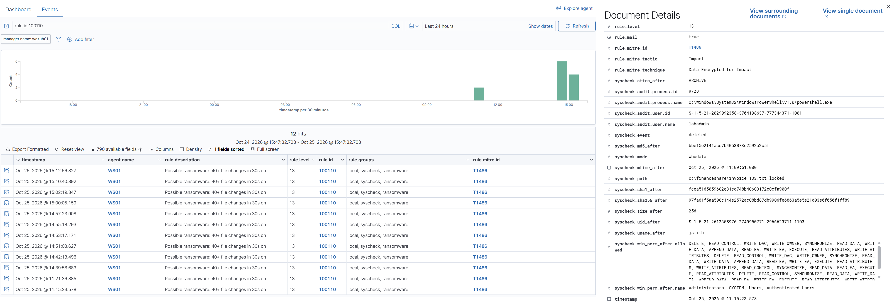

### 2. Malicious file drop with VirusTotal (T1204.002)

File Integrity Monitoring watches a drop folder (`C:\LabDrop`) in real time. A custom rule tags only
events from that folder (`vt_scan` group), and *only* those events are sent to
VirusTotal — this keeps the free API (4 lookups/min) from being exhausted by
unrelated FIM noise. A match raises Wazuh's built-in VirusTotal alert (`87105`).

- **Test:** `tests/T1204_eicar_drop.ps1` writes the harmless EICAR test string under
  a unique filename each run (so FIM always sees a new file).
- **Design note:** a Defender exclusion on the drop folder stands in for "AV missed
  it," so the sample survives long enough for the pipeline to inspect it.
- **Negative test:** a benign file yields the new-file alert but a clean VirusTotal
  result (no `87105`).

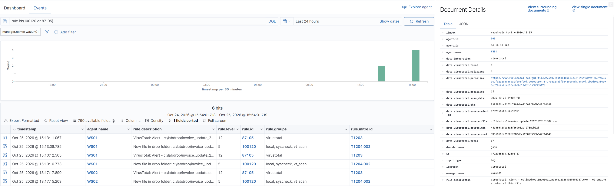

### 3. Defender tampering (T1562.001)

The agent collects `Microsoft-Windows-Windows Defender/Operational`. Four rules
cover the common tamper signals:

| Rule | Event ID | Meaning |
| --- | --- | --- |
| 100130 | 5001 | Real-time protection disabled |
| 100131 | 5010 / 5012 | Antispyware / antivirus scanning disabled |
| 100132 | 5007 | Configuration change — exclusion added |
| 100133 | 5013 | Tamper Protection **blocked** a change (a failed attempt still alerts) |

- **Test:** `tests/T1562.001_defender_tamper.ps1` (`-Run`/`-Reset`) disables RTP and
  adds an exclusion, then cleanly reverses both.
- **Evidence:** RTP-off alert fires on Defender
  event 5001; confirmed in the all-rules dashboard view below. The raw 5007 event,
  showing the `new Value` exclusion field, is saved as `samples/` JSON (see
  `samples/5007_json.json`).

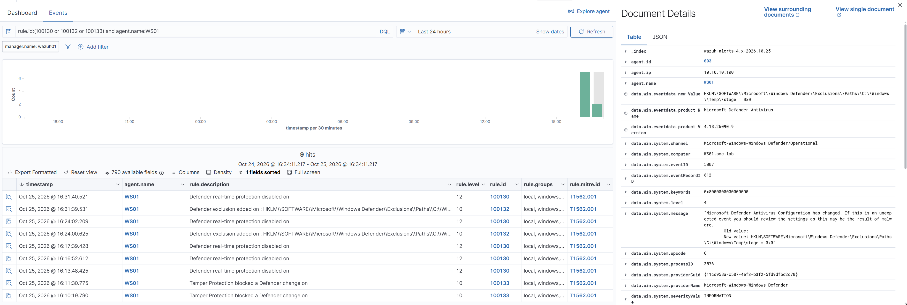

### 4. Password spray → successful logon (T1110.003 → T1078)

The highest-value detection, because it correlates events host-only tooling is unable to do:

- `100140` — 8+ failed logons (`60122`) on one host, across **different** usernames
  (`different_field` on `targetUserName`) within 60 seconds. This is what separates a
  spray (many users, one try each) from a single user mistyping a password.
- `100141` — a **successful** logon on the same host within 120 seconds of
  a `100140`. This is the "they got in" alert and maps to T1078; it drives the
  account-disable containment described below.

- **Test:** `tests/spray.sh` runs from Kali via NetExec against the DC (one password
  across many accounts, then the correct password on one).
- **Evidence:** both `100140` (spray) and `100141` (spray → success) appear in the dashboard view below; `100141` names the compromised account (`erin`) and
  carries both T1110.003 and T1078 tags.

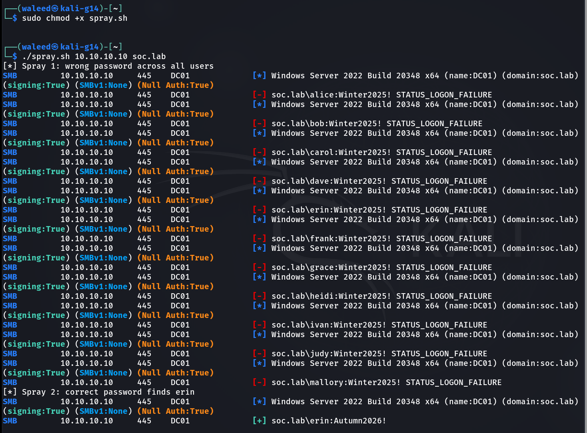

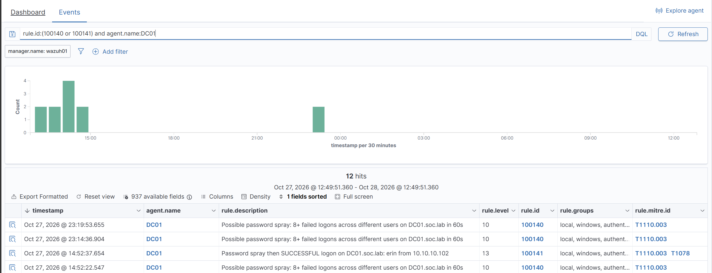

### 5. CIS hardening via Group Policy (SCA)

Wazuh's Security Configuration Assessment scored each host against the appropriate
CIS benchmark (Windows 11 v3.0.0 for workstations, Windows Server 2022 v2.0.0 for
the DC). Five findings were remediated **via Group Policy**:

| CIS check | Remediation |
| --- | --- |
| 26056 | LAN Manager auth level → NTLMv2 only, refuse LM & NTLM |
| 26040 | Block anonymous enumeration of SAM accounts and shares |
| 26031 / 26035 | SMB signing required (client and server) |
| 26053 | Kerberos encryption types → AES only (removes RC4) |
| 26005 / 26006 / 26007 | Account lockout: threshold 5, 15-min duration, 15-min reset |

A `Lab - Workstation Hardening` GPO (registry-based security options) was linked to
the Workstations OU; the account-lockout policy was set on the domain via
`Set-ADDefaultDomainPasswordPolicy`, since lockout for domain accounts is governed
domain-wide, not per-OU.

| Host | Before | After |
| --- | --- | --- |
| WS01 | 25% | 27% |
| WS02 | 25% | 27% |
| DC01 | 27% | 27% (not yet remediated) |

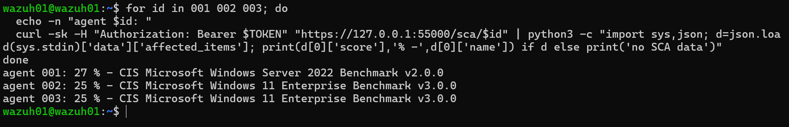

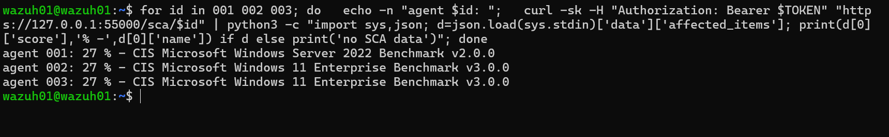

- *GPO applied via Group Policy, not local edits.* `Lab - Workstation Hardening` was
  created with `New-GPO`, populated with five `Set-GPRegistryValue` entries, and
  linked to `OU=Workstations,OU=SOCLab,DC=soc,DC=lab`. The exact registry values
  pushed are in `rules/`, `config/` and reproduced in the remediation table above.
- *Per-check verification.* After the re-scan, SCA checks 26056, 26040, 26031, 26035
  and 26053 flipped from `failed` to `passed` (verified via the indexer API).
- *Lockout policy (not visible in the Win11 SCA score).*
  `Get-ADDefaultDomainPasswordPolicy` confirms threshold 5, 15-minute duration,
  15-minute reset window.

The score delta is small *because the CIS benchmark has several hundred checks* —
clearing ~9 moves the needle ~2 points. The value here is demonstrating the full
loop (read findings → remediate via GPO → re-scan → verify specific controls now
pass), not the headline percentage. Several chosen fixes also tie back to the
detections above: blocking anonymous enumeration cuts the recon that precedes a
spray, and account lockout is the *control* that answers the spray `100141` detects.

---

## Automated validation test

`tests/run_detection_tests.py` does the following:

1. Runs each attack simulation (local PowerShell on WS01, or the spray over SSH to
   Kali).
2. Polls the Wazuh indexer API for the expected rule IDs on the correct target host.
3. Reports PASS/FAIL per rule with **detection latency** (attack start → first alert).
4. Writes a timestamped CSV and returns a non-zero exit code on any failure.

Each detection is one entry in a declarative test table (target host, setup, fire
step, expected rule IDs, cleanup), so adding a detection is a few lines.

### Representative run

_(7/7 checks passed on the final clean run. The VirusTotal check (`87105`) is
consistently slower than the local FIM alert — that gap is the external API round
trip.)_

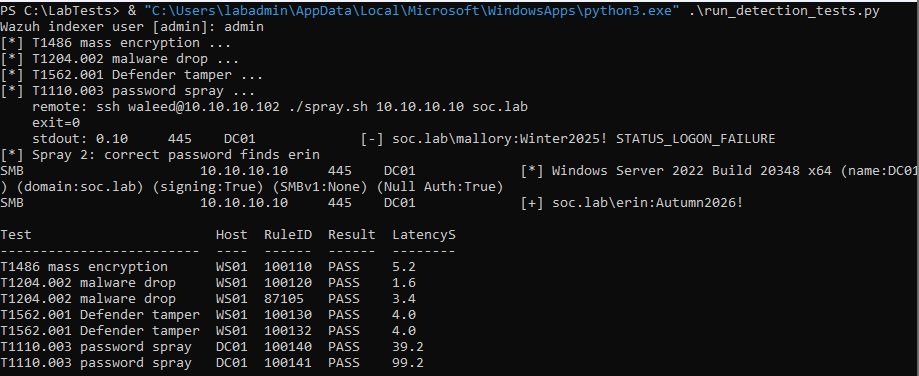

---

## Containment (active response)

Three active responses turn detections into automatic containment. Each is
**stateful**: Wazuh runs it on `add` and reverts it on `delete` when the timeout
lapses, so nothing stays changed permanently.

| Action | Trigger | What it does | ATT&CK |
| --- | --- | --- | --- |
| Disable account | 100141 (spray → success) | Disables the compromised AD account, re-enables on timeout | T1078 |
| Isolate host | 100110 (ransomware) | Blocks all traffic except to the Wazuh manager, restores on timeout | T1486 |
| Block IP | 100140 (spray burst) | Firewall-blocks the attacker's source IP, removes on timeout | T1110.003 |

A single spray triggers two responses at once: `netsh` blocks Kali's IP (off 100140)
while the account-disable removes erin's access (off 100141) — defense in depth from
one detection.

**Safe by construction.** The account-disable script acts only on accounts inside
`OU=TestUsers,OU=SOCLab`. Machine accounts (anything ending in `$`), admins and
service accounts are refused and logged, whatever alert reaches the script — an
allowlist, not a denylist, so a misfiring rule could never disable `DC01$` or an
administrator.

**Launcher, not a compiled script.** The Wazuh Windows agent runs active responses
as `.exe` files and exchanges JSON with them over stdin/stdout. A PS2EXE-compiled
script consumes stdin itself and breaks that exchange, so each response is a readable
`.ps1` behind a small C# launcher (`active-response/ar-launcher.cs`) that passes the
agent's stdin/stdout straight through.

**Account disable** (rule 100141):

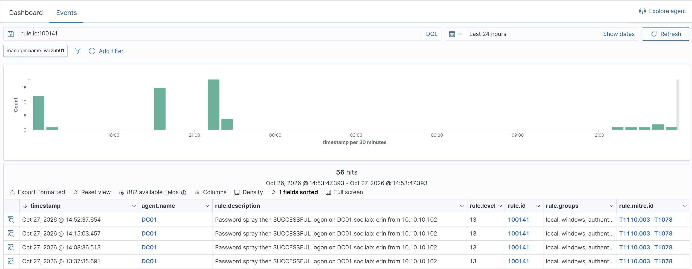

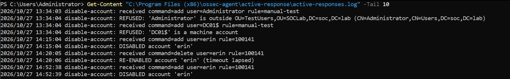

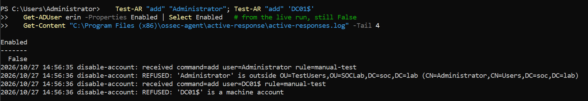

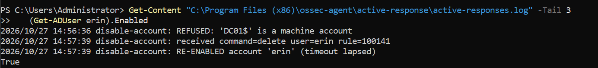

**Host isolation** (rule 100110):

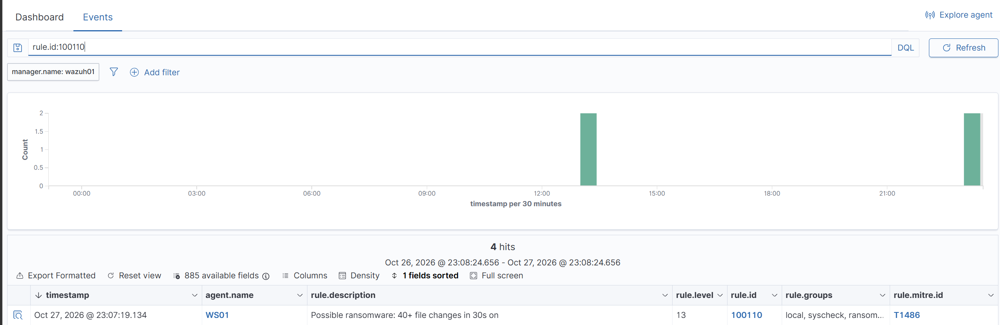

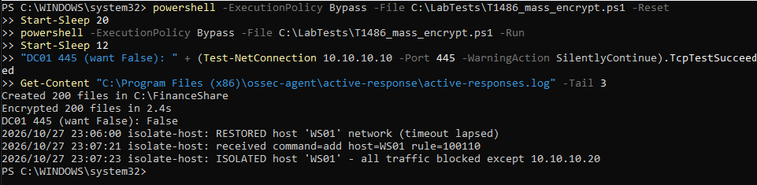

**IP block** (rule 100140):

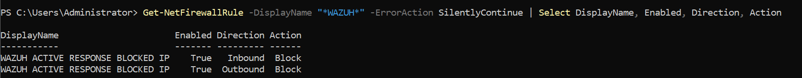

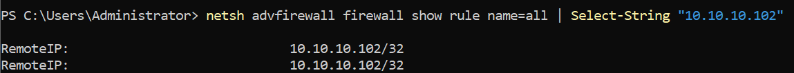

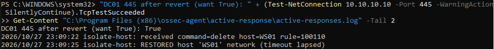

---

## Tuning log

Notes worth keeping — most of these are failures the **validation test** surfaced that
manual spot-checking would have hidden:

- **Defender event fields arrive with spaces.** Event 5007's value field is
  `win.eventdata.new Value` (lowercased first letter, space preserved), not
  `newValue`. Found by enabling the raw event archive temporarily. Field-name
  mismatches are a top cause of detections that never fire.
- **Defender removed the drop folder.** A malware-drop test "failed" because
  Defender had deleted `C:\LabDrop`; the validation test caught it because it checks for the
  *alert*, not that the script ran. Added a pre-check that the folder exists and is
  excluded.
- **Cross-host clock skew.** WAZUH01 ran ~5 s off WS01. Because the spray's alert is
  processed on a different host than the validation test clock, this could exclude a real
  alert from the time-filtered query; fixed with a grace margin in the query window.
- **Frequency threshold vs. attack size.** `100140` was initially set to 8 failures
  but the first spray only hit 5 accounts, so it couldn't fire. Fixed by expanding
  the spray user list to keep a meaningful threshold.
- **`same_location` on the burst rule** keeps per-host counts separate so WS01 and
  WS02 activity never sum together.
- **The spray-success rule fired only on false positives at first.** `100141` was
  keyed on rule `60106`, which matches the DC's own `DC01$` machine-account loopback
  logons (`::1`/`fe80:`), never the attacker. erin's real remote logon comes through
  on rule `92652`. Fixed by correlating on `92652` and excluding machine accounts,
  `ANONYMOUS LOGON` (the spray's null-session probes) and loopback/link-local source
  IPs, so the alert fires only on a real authenticated account from a remote host.
- **An active-response `.exe` built with PS2EXE never saw its stdin.** The agent
  passes the alert JSON on stdin, but a PS2EXE binary consumes it before the script
  runs, so `targetUserName` came back empty. Replaced with a C# launcher that execs
  `powershell.exe` on the `.ps1` and inherits stdin/stdout; confirmed against the
  Wazuh custom active-response docs.
- **Containment safety moved from a denylist to an OU allowlist.** An early script
  kept a list of names to never disable; a machine-account alert slipped past it.
  Restricting actions to `OU=TestUsers` makes disabling the DC or an admin
  structurally impossible, regardless of what rule fires.

---
